<p align="center">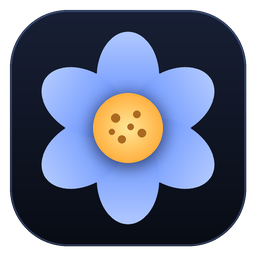</p>

# Pollen

A lightweight native dock and notch for Windows that replace the taskbar, written in
Rust with Direct2D. No WebView, no GPU device, no background polling: about 15 MB in
Task Manager, one 1 MB program.

> Early stage. Windows 10/11, x64. In English and Turkish (it follows Windows' language,
> or pick one in Settings).

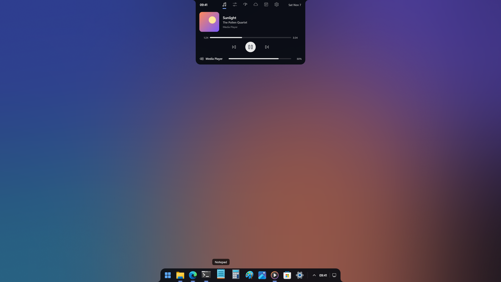

<table>
  <tr>
    <td colspan="2" align="center">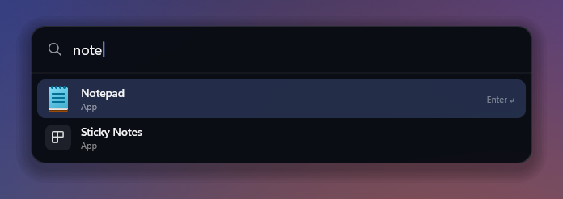</td>
  </tr>
  <tr>
    <td>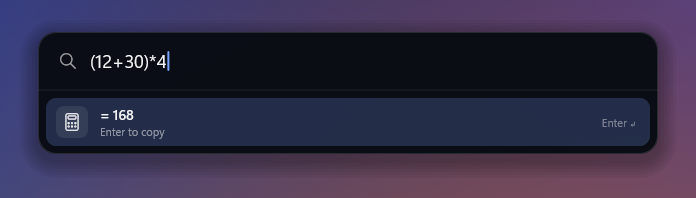</td>
    <td>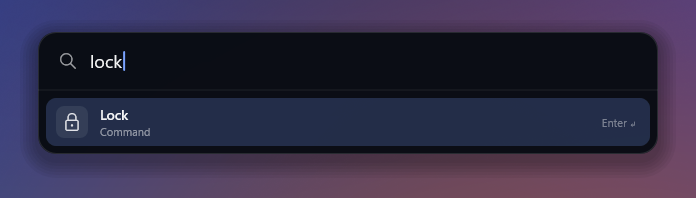</td>
  </tr>
  <tr>
    <td colspan="2" align="center">The launcher (Alt+Space): apps, recent files, sums and commands</td>
  </tr>
  <tr>
    <td>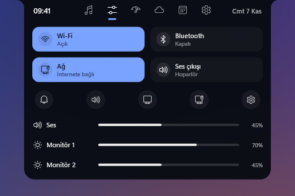</td>
    <td>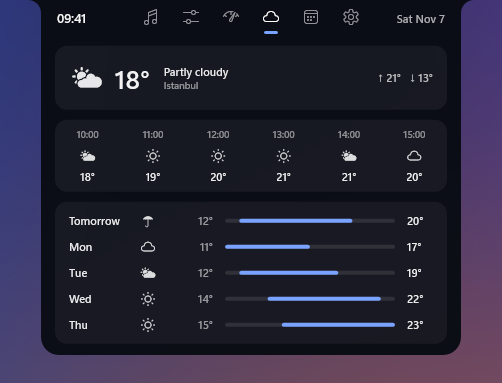</td>
  </tr>
  <tr>
    <td align="center">Control Center: Wi-Fi, sound, each monitor's brightness on its own</td>
    <td align="center">Weather: now, the next hours and days</td>
  </tr>
  <tr>
    <td>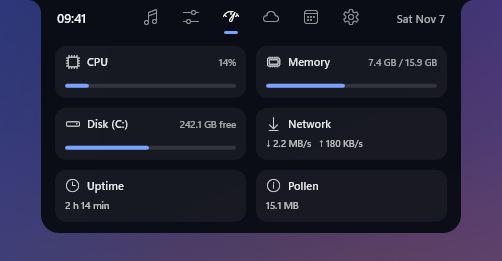</td>
    <td>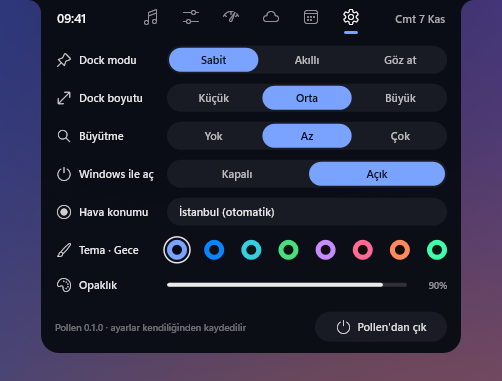</td>
  </tr>
  <tr>
    <td align="center">Status: CPU, memory, disk, network</td>
    <td align="center">Settings: dock mode, size, language, theme, place</td>
  </tr>
  <tr>
    <td>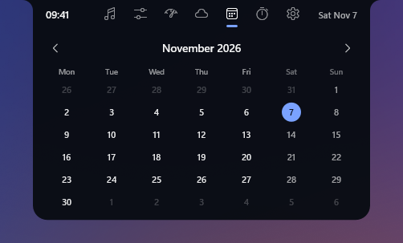</td>
    <td>
      <br><br>
      
    </td>
  </tr>
  <tr>
    <td align="center">Calendar</td>
    <td align="center">Closed: what is playing, the volume indicator</td>
  </tr>
  <tr>
    <td>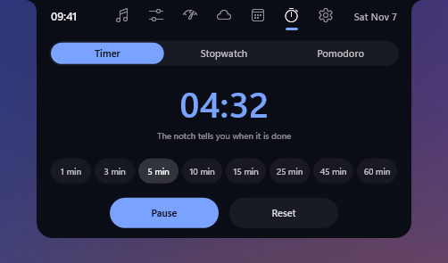</td>
    <td>
      <br><br>
      
    </td>
  </tr>
  <tr>
    <td align="center">Timer, stopwatch and pomodoro</td>
    <td align="center">The time left on the closed notch; a banner when it is up (and for new notifications)</td>
  </tr>
  <tr>
    <td>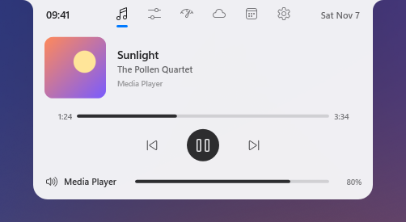</td>
    <td>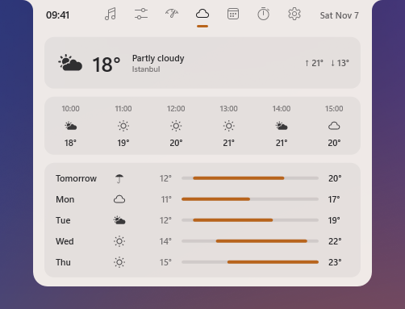</td>
  </tr>
  <tr>
    <td>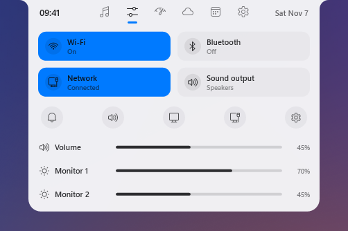</td>
    <td>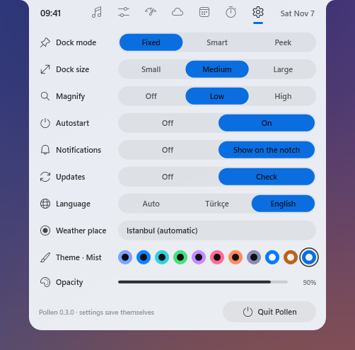</td>
  </tr>
  <tr>
    <td colspan="2" align="center">Light themes: Light, Latte and Mist</td>
  </tr>
</table>

The screenshots are rendered by Pollen itself with made-up data
(`Pollen.exe --demo-shots <folder> --english`, then `python docs/make_screenshots.py <folder>`).

## Install

1. Download `Pollen.exe` from the [latest release](../../releases/latest).
2. Run it and choose **Install**. Pollen installs for your user only, with no
   admin rights: into `%LOCALAPPDATA%\Programs\Pollen`, with a Start menu shortcut.
3. To remove it: Settings › Apps › Installed apps › Pollen › Uninstall.

Pollen looks for a newer release once a day and offers it from its tray icon and the
Settings tab (turn this off under Settings › Updates). Running a newer `Pollen.exe`
by hand updates the installed one too; your settings and pins stay. The program is not signed yet, so SmartScreen may warn the first time
(More info › Run anyway).

Command line: `Pollen.exe --install` installs or updates without asking,
`--here` runs a copy without installing, `--uninstall` removes Pollen.

## What works

- Replaces the Windows taskbar, with a dock on every monitor (the same apps on each;
  monitors that come and go get or lose theirs)
- Looks like Nectar's dock: Nectar's "Midnight" color, attached to the bottom edge,
  rounded on top with small inward flares, macOS-style magnification; optional boxes
  behind the icons, as in Nectar (Settings › Icon boxes)
- Animations run in step with the display's refresh rate (144 fps on a 144 Hz screen)
- Nectar's motion: hiding shrinks the bar into a circle that sinks below the edge;
  showing raises the circle, flattens it against the edge and spreads it into the bar
- Three modes (right-click the dock, or the notch's Settings tab):
  - **Sabit (Fixed):** always visible, reserves its strip. While a window is
    maximized or snapped down to it, the bar widens to the full screen width, so the
    strip never shows bare wallpaper beside the bar; the tray and the clock go to
    the corner and the icons stay in the middle of the screen, as on the taskbar
  - **Akıllı (Smart):** reserves nothing, hides while a window covers it
  - **Göz at (Peek):** hidden until the mouse reaches the bottom edge
- The Windows taskbar pins, in the same order, including Store apps pinned from Start
- Running apps that are not pinned, after a separator
- Drag an icon sideways to move it; the others slide out of the way. Pins keep
  the new order (in `%APPDATA%\Pollen\pin-order.txt`; Windows' own taskbar pins
  are not changed), running apps keep it until Pollen restarts
- Windows' own minimize/restore animation flies into and out of the app's dock icon
- An app's icon rises out of a small bulge in the bar when it opens and melts back in
  when it closes
- Tray: a "hidden icons" button opens Windows' own notification-area flyout right
  above it, so tray apps (Steam, Discord, ...) and their menus work as usual
- Start button, a clock (click: notifications and calendar) and the taskbar's
  show-desktop button at the right end (in the screen's corner when full width)
- Click to open, click a running app to focus it, again to minimize, or to cycle its windows
- Apps open through Explorer, as from the taskbar: they are Explorer's children,
  not Pollen's (tools that group processes by parent, such as PC Manager, don't
  count their memory as Pollen's), and they get Explorer's current environment
  (a PATH changed after Pollen started included)
- Right-click menu: the app's jump list as on the taskbar (its tasks such as "New
  InPrivate window", its own categories, and recently opened files when Windows'
  "Show recently opened items" setting is on), then new window, close the window
  (or all of them), pin to / remove from the dock, and a Pollen submenu with the
  mode and quitting. Pins made in Pollen are kept in `%APPDATA%\Pollen\pins.txt`; removing one of
  Windows' own taskbar pins only hides it from the dock (`hidden-pins.txt`), since
  Windows does not let other apps change its pins
- An icon in the notification area: click for the Settings tab, right-click for
  Settings, starting with Windows, and quitting
- Window previews (Nectar's): hovering a running app shows a live thumbnail of
  each of its windows, with its title; click one to switch to it, close it with
  its × (or a middle click). Minimized windows show the app's icon
- Hides while a fullscreen window is the top window on its monitor, even when the
  focus is on another monitor
- Per-monitor DPI

### Launcher

- **Alt+Space** opens a search box in the middle of the screen (also in the tray
  icon's menu). It finds every app the Start menu lists, desktop and Store apps
  alike, by name, word or initials ("vsc" for Visual Studio Code); files opened
  lately; sums such as `(12+30)*4` (Enter copies the result); and commands: lock,
  sleep, restart, shut down, sign out, empty the Recycle Bin, Pollen settings.
  Restarting and the like ask for a second Enter
- Apps opened from it often rank higher. If another program (PowerToys Run, for
  one) already uses Alt+Space, the launcher stays in the tray menu only

### Notch

- An island attached to the top of the primary monitor (Nectar's look and opening)
- It can sit anywhere along the top edge (drag the open notch by the time or the
  date in its top row; it snaps to the ends and the middle), or stand on the left
  or right edge as a tall pill whose panel slides out sideways
- Settings › Notch › On hover: it hides above the screen and opens when the mouse
  touches the edge where it sits; notifications and the volume still show
- Closed: time and date; while something plays, its art and level bars driven by
  the output's real peak meter. Hovered: opens with icon tabs across the top, on
  Music if something plays, else on the Control Center
- Music: what Windows' media sessions report (Spotify, browsers, players): art,
  title, artist, player, a progress bar to seek, previous / play-pause / next, and
  a picker when several players have sessions, and a slider for the player's own
  volume in the Windows mixer (for a browser that is the whole browser, not one tab). Event driven; position-only
  updates (sent about every second by live streams) get a light read
- Control Center: network and sound-output tiles (Wi-Fi / Bluetooth tiles when the
  computer has them), shortcut buttons, and sliders for the volume and for each
  monitor's brightness separately over DDC/CI (Nectar changed all monitors at once)
- Status: CPU, memory, free space on C:, network speed, uptime and Pollen's own
  memory
- Weather: now (with today's high and low), the next six hours and the next five
  days. When nothing plays, the closed island shows the weather on the left, the
  time in the middle and the date on the right
- Microphone and camera: while an app uses them, an orange (microphone) or green
  (camera) dot shows on the closed island and the app's name in the open one. Read
  from what Windows records about each app's use, waiting for changes (no polling)
- Volume: changing it from the keyboard or elsewhere widens the closed island for
  a moment to show the level (Windows' own indicator still shows too; Windows 11
  draws it inside Explorer, with no window another program could hide)
- Timer: a timer with quick lengths, a stopwatch and a pomodoro (25 minutes of
  focus, 5-minute breaks, a 15-minute one every fourth round). The closed island
  shows the time left; when it is up, a banner and Windows' alarm sound
- Notifications: a new Windows notification shows on the closed island for a few
  seconds (not over fullscreen games; Settings › Notifications turns it off). Windows
  only lets packaged apps subscribe to notifications, so Pollen checks the write time
  of Windows' notification store every 1.5 s (microseconds) and reads the list only
  when it changed
- Headphones: Bluetooth devices that report a battery level get a tile in the
  Control Center
- Calendar: a plain month view (Monday first), today highlighted, previous / next
  month. No accounts or calendar sync
- Settings: the language (Auto follows Windows; Türkçe or English), the dock's mode,
  size, magnification and icon boxes, the notch's edge, place and hiding, starting with Windows (off
  until turned on; a value under the user's `Run` key), the weather's place, the
  theme (Nectar's presets: Midnight, Graphite, Ocean, Forest, Plum, Rose, Ember;
  the light Light, Latte and Mist; or Windows, which follows Windows' accent color
  and its light or dark mode), the background opacity of the
  dock and the notch, and quitting Pollen. Hovering an option explains it. Changes
  apply at once and are saved in `%APPDATA%\Pollen\settings.txt`

The weather comes from [Open-Meteo](https://open-meteo.com/) for a rough location
looked up from the computer's public IP address (ipwho.is, falling back to
geojs.io), refreshed every 30 minutes. A place typed in the Settings tab (found
with Open-Meteo's geocoding) replaces the IP lookup; "Otomatik" goes back to it.

## Getting the taskbar back

Quitting Pollen (right-click › Quit Pollen, or the tray icon's menu) restores the taskbar. If Pollen was
killed or crashed, starting it again restores it first, or run:

```powershell
pollen.exe --restore-taskbar
```

## Not yet

- Per-monitor choices (each dock shows the same apps and uses the same mode)

## Build

```powershell
cargo build --release
.\target\release\pollen.exe
```

Debug helpers (use a debug build, which has a console):

- `pollen.exe --diag` prints the pins and windows the dock sees.
- `pollen.exe --snapshot <folder>` renders the dock's and the notch's animations to
  PNG files without showing anything on screen.
- `pollen.exe --controls` prints the sound output, network, monitors and their
  brightness, the media sessions, system use and the weather as the notch sees them.

## Credits and license

Pollen is inspired by [Nectar](https://github.com/kua8/Nectar) by kua8, which grew out
of [Bloom](https://github.com/SehajveerSingh2005/bloom) by Sehajveer Singh. Parts of
Pollen's Win32 code (reading taskbar pins, AppUserModelIDs, file descriptions, hiding
and restoring the taskbar) are ported from Nectar, so Pollen is licensed under the same
[GPL-3.0](LICENSE).
